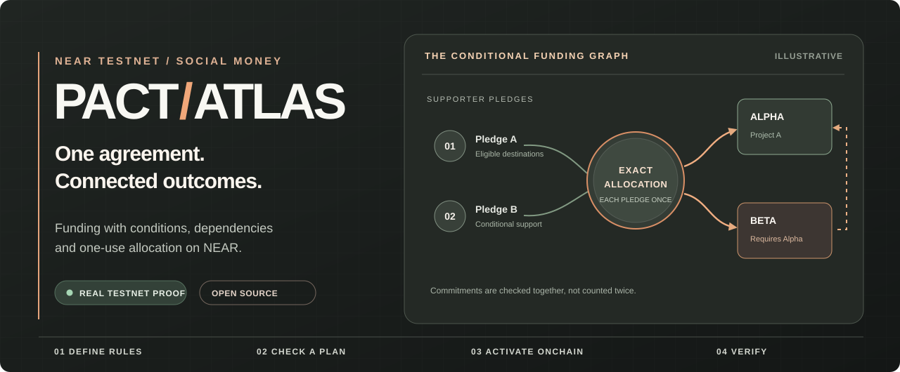
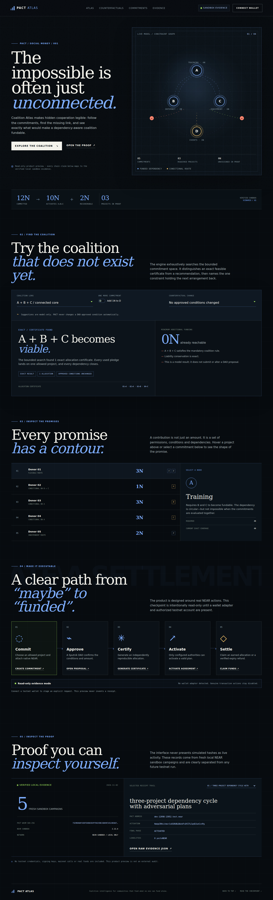
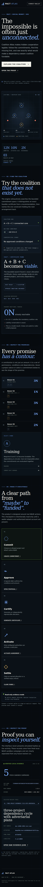
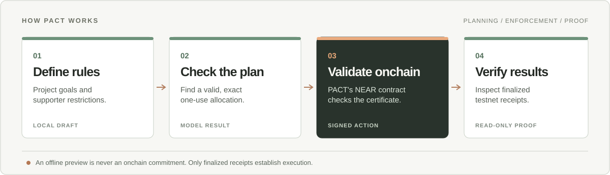

# PACT Atlas

**Conditional community funding on NEAR.** Build agreements in which project goals, supporter restrictions and cross-project dependencies must all be satisfied together. One pledge is assigned at most once. The contract verifies the allocation before releasing funding.

**NEAR HACKATHON 2026 · Social Money · Experimental testnet product**

[**Launch PACT Atlas**](https://pact-atlas-near-connect.vercel.app/) · [**Watch the demo**](https://x.com/saitama_xc/status/2121722670546919654) · [Explore campaigns](https://pact-atlas-near-connect.vercel.app/console) · [Create an agreement](https://pact-atlas-near-connect.vercel.app/create.html) · [Verify a transaction](https://pact-atlas-near-connect.vercel.app/verify.html)

[](https://github.com/Iniwura/pact-atlas/actions/workflows/checks.yml)  



> **At a glance:** A working, open-source NEAR testnet application with a campaign directory, a self-service funding-plan editor, an exact bounded allocation engine, wallet connection, contract-backed conditional activation, public activity, and an independent receipt verifier. Three actual testnet campaigns have completed funding/activation or expiry/refund lifecycles; **all 11 recorded PACT method calls were reverified on 14 November 2026** using archival NEAR RPC. This remains testnet-only and is not a production financial service.

## Why PACT exists

Ordinary project-by-project fundraising answers one question: *Did this project meet its goal?* Community initiatives often require a harder answer: *Can this entire connected set of projects be funded without breaking anyone's conditions?*

Consider two projects:

- **Alpha** can operate independently.
- **Beta** should only proceed if **Alpha** is funded.
- A supporter will fund Beta **only if Alpha also succeeds**; another supporter is willing to support more than one destination, but their single pledge cannot be spent twice.

Checking individual funding totals is not enough. PACT must find a consistent assignment of actual pledges, respect the project dependency, and prevent double allocation.

**PACT Atlas turns that collective agreement into something organizers can design, supporters can inspect, a NEAR contract can enforce, and anyone can verify.**

## The product

| Experience | What a person can actually do |
| :-- | :-- |
| **Discover** | Browse public testnet campaigns, inspect project terms and filter funded or expired outcomes. |
| **Create** | Start from a blank agreement, define projects and goals, add supporter contributions, permissions and dependency rules. |
| **Plan** | Check whether the whole arrangement is feasible; inspect an exact, one-use candidate allocation or an honest blocked/undetermined result. Export a reproducible model proof. |
| **Connect and act** | Connect a NEAR testnet account through **NEAR Connect**; review separately approved requests for permitted funding, activation or settlement actions. |
| **Follow** | Inspect a campaign’s recorded commitments, accepted activation certificate, beneficiary withdrawals, expiry and refunds. |
| **Verify** | Check a real transaction’s signer, destination, called method, finalized receipts and the contract's current code hash using read-only archival RPC. |

### Explore the actual interface

The live product is the authoritative reference. These existing repository captures show the interface at desktop and mobile sizes.

<details>
<summary><strong>Open desktop and mobile product screenshots</strong></summary>

<p align="center">
  <a href="docs/design-evidence/pact-atlas-premium-desktop.png"></a>
  <a href="docs/design-evidence/pact-atlas-premium-mobile.png"></a>
</p>

[Open the desktop screenshot](docs/design-evidence/pact-atlas-premium-desktop.png) · [Open the mobile screenshot](docs/design-evidence/pact-atlas-premium-mobile.png)

</details>

### A five-minute judge walkthrough

No wallet or funds are required to inspect the existing public evidence.

1. **Start at [the workspace](https://pact-atlas-near-connect.vercel.app/console).** Select **Guide** for the first-visit tour, then explore **Campaigns**. Open the recorded Alpha/Beta coalition.
2. **Understand the dependency.** Beta requires Alpha. Inspect the immutable campaign terms and the accepted allocation certificate rather than trusting a marketing summary.
3. **Try [Create](https://pact-atlas-near-connect.vercel.app/create.html).** Add projects, beneficiary goals, supporter amounts and restrictions, then check the funding plan. This preview is a **local model result**, not a signed transfer.
4. **Follow the real outcome.** In **Activity**, inspect the original commitments, activation and both beneficiary withdrawals. Open the expired campaign for the separate contributor refund.
5. **Independently [Verify](https://pact-atlas-near-connect.vercel.app/verify.html).** Choose **Load real example → Verify on NEAR** and inspect the archival RPC result. An unavailable or incorrect receipt is never displayed as verified.

**[Watch the PACT Atlas product demo on X](https://x.com/saitama_xc/status/2121722670546919654).** Recorded product film published for NEAR HACKATHON 2026.

## How the funding system works



The system deliberately separates **planning**, **wallet-approved actions** and **onchain facts**:

**1. Define a complete agreement.** Each campaign specifies project goals, eligible pledge destinations, supporter conditions, dependencies, activation authorities and deadlines. The local editor supports **1–5 projects** and **1–8 supporters** with bounded, whole-amount scenarios; its limits are explicit.

**2. Check an allocation.** The bounded exact solver searches for an arrangement where each pledge is used once, project targets are satisfied and dependencies remain valid. It can explain why a scenario is blocked or undetermined. A candidate certificate is a *proposal*, not a blockchain outcome.

**3. Validate and activate on NEAR.** A campaign has its own immutable Rust/Wasm contract. The contract independently checks the authorized activation request and exact allocation certificate against canonical recorded pledges. A valid certificate is retained onchain; a UI preview alone cannot activate a campaign.

**4. Settle or refund.** Credited beneficiaries can withdraw through a pull-payment flow. If an agreement expires without activation, contributors retain claimable credits. The contract exposes an accounting view covering locked pledges, credits, pending transfers and liabilities.

**5. Read the public record.** The verifier checks finalized execution against public NEAR testnet archives. It does not need wallet access, a private key or trust in the PACT front end.

### What makes the mechanism different?

| Simplified funding model | What it measures | What it does **not** establish |
| :-- | :-- | :-- |
| Independent project totals | A separate threshold per project | That a flexible contribution is counted only once across all projects |
| Aggregate threshold pool | Whether pooled capital can cover some set of targets | Per-pledge destination restrictions and dependency closure |
| **PACT's exact bounded allocation** | A one-use assignment with checked goals, permissions and dependencies | Project delivery, guaranteed optimal results at unlimited scale, or production financial safety |

These are the explicit semantics of the [reproducible benchmark](docs/COMPETITIVE_ADVANTAGE.md), **not** a claim that all existing crowdfunding systems double-count pledges. PACT builds on prior work in conditional and coalition funding. Its present differentiation is an executable NEAR-native constraint-verification and settlement product, not a claim to have invented the field.

## Onchain evidence: three completed testnet campaigns

The product is backed by original NEAR testnet transactions from **10 November 2026**, executed using disposable faucet-funded testnet accounts and CLI signers. On **14 November 2026**, all **11 recorded PACT method calls** across the three campaigns were rechecked against archival NEAR testnet RPC and returned successful finalized execution with matching signer, contract, method, receipt outcomes and pinned current contract code hash.

| Campaign | Actual recorded result | Inspect |
| :-- | :-- | :-- |
| **Single-project activation** | Contribution → activation → beneficiary withdrawal | [Funding](https://testnet.nearblocks.io/txns/EbaYMGUVXhKz1hzY6BxXsEUwkvV3otZo1d4RBarUtjqf) · [Withdrawal](https://testnet.nearblocks.io/txns/Csd1ERWsUkAgmDkjJKxiZxS79C8aHdLP6sC4J5xNaeRb) |
| **Expired campaign** | Contribution → expiry → contributor refund | [Expiry](https://testnet.nearblocks.io/txns/BsD14fSst4b6BSDqZ6v8WkZqHCQXKXupfPrwfNDtyGFK) · [Refund](https://testnet.nearblocks.io/txns/C4yMtrjmWoBRmRutTWfdCLEeY3XDrct8ydCx2ZBtTzvT) |
| **Two-project coalition** | Beta's restricted pledge arrived before Alpha's; both projects then activated and their beneficiaries withdrew | [Beta pledge](https://testnet.nearblocks.io/txns/39QG8aueJBWZEcJYHZtVorjbyc9WJiJ1u9gdz9WjuDKN) · [Activation](https://testnet.nearblocks.io/txns/31FxH2YE9FEm7iq49AH6eXMvZYiFv7Y3jeqd8rThK96v) · [Payout A](https://testnet.nearblocks.io/txns/BF7DB9Ap711cXLfnQnUweN1Q6LgUkUGmbFP3HfcxEkex) · [Payout B](https://testnet.nearblocks.io/txns/GuUpGeBNaygqoaepXPrmxbWgEzexoXgyxxFDZ617E9FX) |

**Recorded final accounting:** all three campaigns finished with zero recorded liabilities and `solvent: true`. The two-project campaign holds an accepted allocation certificate, not just a solver prediction.

Explore the complete, reproducible evidence manifests:

- [Single-project and expiry/refund records](evidence/pact-atlas-testnet-evidence-2026-11-10.json)
- [Two-project coalition records](evidence/pact-atlas-testnet-coalition-evidence-2026-11-10.json)
- [Public testnet verification methodology](docs/TESTNET_PROOF.md)

These transactions were **CLI-signed**. A real Meteor account connection through NEAR Connect has been confirmed separately, but a browser-signed PACT contract call has **not** been independently verified. We do not represent one as the other.

### Verify a real receipt yourself

With Node.js **22.22.2+** installed:

```bash
git clone https://github.com/Iniwura/pact-atlas.git
cd pact-atlas
npm ci

npm run verify:testnet -- \
  coalition-20261110.beneficiary-20261110.testnet \
  refund-supporter-20261110.testnet \
  39QG8aueJBWZEcJYHZtVorjbyc9WJiJ1u9gdz9WjuDKN \
  commit
```

Expected result when the archival RPCs are reachable: **`VERIFIED NEAR TESTNET PACT EXECUTION`**, with successful final receipts and the expected current contract code hash. Unknown finality, provider failures and mismatched transaction identities **fail closed**.

The verifier checks the **current** Wasm code hash, not a historical code hash at the transaction's original block. It does not certify the protocol's security or project delivery.

## Run PACT Atlas locally

```bash
git clone https://github.com/Iniwura/pact-atlas.git
cd pact-atlas
npm ci
npm run preview
```

Open **http://127.0.0.1:4173/console**. You can explore campaigns, edit a new funding plan, use the guided tour and inspect archived public proof without connecting a wallet. A network read may fail closed if testnet RPC is unavailable.

### Reproduce the engineering checks

```bash
# Funding semantics and solver comparison
npm test
npm run test:benchmark
npm run test:counterfactual

# Request construction, onchain reads, proof and wallets
npm run test:workflow
npm run test:chain
npm run test:proof
npm run test:wallet-adapter
npm run test:wallet-selector

# Actual browser flows; install Chromium once
npx playwright install --with-deps chromium
npm run test:browser
```

The final executed product checks recorded **121 passing Chromium browser cases** and **110 passing Node cases**. The GitHub workflow also executes pinned Rust contract/ABI/Wasm and fresh local NEAR sandbox checks. See the current [CI history](https://github.com/Iniwura/pact-atlas/actions/workflows/checks.yml) for exact run status and artifacts.

For byte-for-byte contract reconstruction, capacity scenarios and local Sputnik governance tests, use [HACKATHON.md](HACKATHON.md). The Rust toolchain is pinned to **1.93.0**; the build checks preserve the optimized Wasm and ABI. The source, manifests and test harnesses remain public.

## Architecture

| Layer | Responsibility | Source |
| :-- | :-- | :-- |
| **Product UI** | Campaign discovery, builder, guide, coalition views, activity and receipt inspection | [Web application](web/) |
| **Allocation model** | Exact bounded search, counterfactuals, one-use pledge constraints | [Reference engine](reference/) · [Browser solver](web/campaign-solver.mjs) |
| **NEAR contract** | Immutable campaign rules, authorized activation, certificates, credits, expiry, withdrawal accounting | [Rust contract](contract/src/lib.rs) · [Pinned artifacts](evidence/) |
| **Wallet boundary** | Account-first NEAR Connect, explicit wallet-approved requests, actual transaction finality | [Connector](web/wallet-selector-host.mjs) · [Wallet adapter](web/near-adapter.mjs) |
| **Read-only trust boundary** | Independently fetch archived transactions, authenticate method/signer/contract/receipt/code hash | [Proof verifier](web/testnet-proof.mjs) · [API](api/verify-testnet.mjs) |

PACT does **not** let a browser-generated candidate allocation pass as an accepted contract certificate. Read-only verification does not require a wallet. Contract deployments are separate accounts, not mutable records in a shared database.

## Security and current scope

**Status: experimental NEAR testnet release. No mainnet deployments, valuable deposits or production guarantees.** This is not an externally audited financial service.

Verified protections include immutable campaign configuration, onchain certificate checks, authorization boundaries, pledge conservation, explicit failure states and fail-closed public receipt reads. Important remaining limitations are:

- **Withdrawal callback liveness:** if a native transfer succeeds but the callback never executes, a withdrawal could remain pending indefinitely. Blind retries or timeouts could double-pay. This remains a high-severity production blocker.
- **Browser signing:** wallet connection has been observed, but no independent end-to-end browser-signed PACT contract transaction has been finalized in the current evidence.
- **Governance:** multi-member Sputnik-style approvals have local sandbox evidence, not a public multi-member testnet vote.
- **External review:** the contract has detailed internal adversarial testing, but no qualified independent security audit.

Review the [withdrawal risk assessment](docs/WITHDRAWAL_REVIEW.md), [security and sandbox record](docs/SECURITY_REVIEW.md), and [final independent build review](docs/FINAL_JUDGE_AUDIT_2026-11-14.md). A successful testnet transaction is evidence of execution, not a blanket security guarantee.

## NEAR HACKATHON 2026

**Track:** Social Money. PACT is a community-funding product that makes cross-project conditions enforceable by a NEAR contract. The public project includes source code, a live testnet experience, deterministic simulations and actual completed NEAR testnet lifecycles.

**For reviewers:** [Live product](https://pact-atlas-near-connect.vercel.app/) · [Full technical reproduction](HACKATHON.md) · [Product submission overview](docs/SUBMISSION_DESCRIPTION.md) · [Testnet evidence](docs/TESTNET_PROOF.md)

**Demo film:** [Watch the submitted PACT Atlas product demo on X](https://x.com/saitama_xc/status/2121722670546919654). For a hands-on walkthrough, launch the [in-product Guide](https://pact-atlas-near-connect.vercel.app/console?tour=1).

**License:** [MIT](LICENSE).
