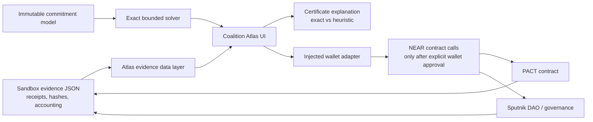
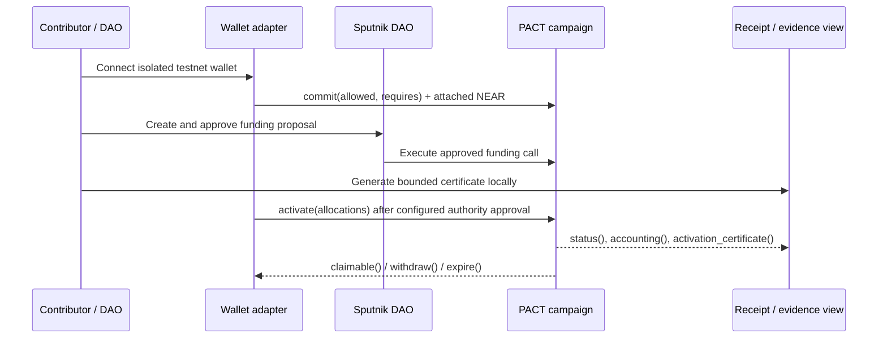

# PACT Atlas architecture

PACT Atlas has two deliberately separate evidence domains: the verified local NEAR execution record and the product's counterfactual model. The interface can explain a model result without presenting it as a blockchain transaction.

## Evidence boundary

- `web/data/evidence.json` is copied from the checked-in `evidence/pact-atlas-sandbox-evidence.json`. It contains fresh local sandbox receipts, account IDs, code hashes and accounting transitions.
- `web/engine.mjs` is deterministic and bounded. It exhaustively enumerates the small demonstration commitment space and returns exact allocation certificates where one exists. It does not claim a general global optimizer.
- The interface labels model-only condition changes and never edits DAO-approved conditions.
- `window.PACT_NEAR_ADAPTER` is an explicit host integration boundary. Without an authorized adapter, the app remains read-only and displays no fabricated transaction hash.
- `web/near-adapter.mjs` is the optional implementation bridge: it accepts a HOT Connect or Wallet Selector-compatible wallet, supports a supplied v10 `functionCall` action creator, reconciles finality views through an injected provider, and rejects missing transaction hashes.

## Contract and governance path

The real sandbox checkpoint verifies the contract, Sputnik governance and conservation identity. It does not constitute a public testnet deployment, an external audit, or proof that an NEAR promise callback can never fail to execute.
